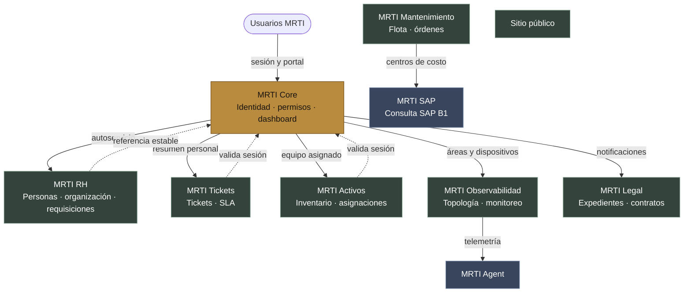

# Mapa visual de la plataforma MRTI

Este archivo es la vista humana del inventario versionado en
[`platform-map.json`](platform-map.json). El JSON es la fuente de datos: toda
edición debe mantener un propietario único por dato y respetar la guía
`CORE_INFRA_MIGRATION_GUIDE.md`.

## Cómo mantenerlo

1. Edita primero `platform-map.json`: nodos, responsabilidades y conexiones.
2. Actualiza este diagrama Mermaid para conservar una revisión visual en Git.
3. Si la modificación cruza módulos, documenta la decisión y el plan de
   compatibilidad en `CORE_INFRA_MIGRATION_GUIDE.md`.
4. No conviertas una flecha de consulta en propiedad de datos: cada dato tiene
   un solo dueño.

## Leyenda

| Tipo de relación | Significado |
|---|---|
| `auth` | El módulo valida sesión y permisos de Core. |
| `self_service` | Core compone una experiencia; el módulo dueño conserva reglas y datos. |
| `reference` | Se conserva un identificador estable, sin llave foránea entre bases. |
| `api` | Integración HTTP explícita y versionable. |
| `telemetry` | Eventos operativos provenientes de Agent. |
